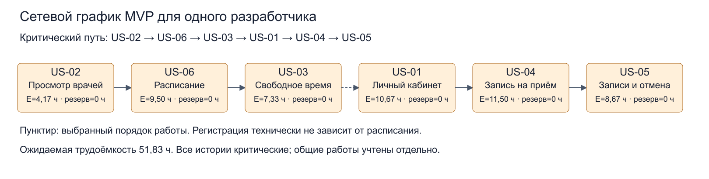

# Сетевой график и прогноз выполнения MVP

## Цель

Построить сетевой график шести историй MVP, определить критический путь и резервы, оценить срок по PERT и выполнить условный прогноз Монте-Карло.

## Исходные данные

Состав MVP — US-01–US-06 из [бэклога](backlog.md); оценки O, M, P в полезных рабочих часах — из [estimates.md](estimates.md). Зависимости и шестинедельный сценарий — из [prioritization.md](prioritization.md).

Работает один разработчик. Доступно 20 ч в неделю, предварительный коэффициент фокуса — 0,7, то есть 14 полезных ч в неделю. Из шестинедельного бюджета 84 ч предварительно выделены 28 ч общих работ; на истории остаётся 56 ч.


## Ход выполнения

### Сетевой график для одного разработчика

Сетевой график показывает последовательность выполнения историй. Критический путь определяет длительность плана; резерв истории показывает, насколько можно сдвинуть её начало без изменения общего срока.

Данные находятся в [mvp-solo.csv](mvp-solo.csv). Выбран порядок US-02 → US-06 → US-03 → US-01 → US-04 → US-05. Он учитывает технические зависимости и выполнение одной истории за раз. Связь US-03 → US-01 задаёт выбранную последовательность работы, а не техническую зависимость регистрации от расписания. Другой допустимый последовательный порядок даст ту же сумму трудоёмкости при тех же оценках и отсутствии затрат на переключение.




### Таблица сроков

ES — раннее начало; EF — раннее окончание; LS — позднее начало; LF — позднее окончание.

| История | E, ч | ES = LS | EF = LF | Резерв, ч |
| --- | ---: | ---: | ---: | ---: |
| US-02 | 4,17 | 0,00 | 4,17 | 0,00 |
| US-06 | 9,50 | 4,17 | 13,67 | 0,00 |
| US-03 | 7,33 | 13,67 | 21,00 | 0,00 |
| US-01 | 10,67 | 21,00 | 31,67 | 0,00 |
| US-04 | 11,50 | 31,67 | 43,17 | 0,00 |
| US-05 | 8,67 | 43,17 | 51,83 | 0,00 |

Критический путь выбранного последовательного графа включает все шесть историй. Сумма E до округления = 51,8333 ч. Резерв каждой истории равен нулю относительно минимального срока этого графа.

### Вероятностный расчёт PERT

Для каждой истории E = (O + 4M + P) / 6, σ = (P − O) / 6. Для последовательного пути складываются ожидаемые часы и дисперсии, а не стандартные отклонения:

E_общ = ΣE_i = 51,8333 ч.

σ_общ = √Σσ_i² = √18,8611 ≈ 4,343 ч.

Для бюджета D часов: Z = (D − E_общ) / σ_общ; P(T ≤ D) ≈ Φ(Z), где Φ — функция распределения стандартного нормального распределения. Предполагаются независимость оценок длительностей и приемлемость нормального приближения суммы. Для шести предварительно оценённых задач это грубый учебный прогноз; общие причины задержек могут нарушить независимость.

В шестинедельном сценарии D = 6 × 20 × 0,7 − 28 = 56 ч. Тогда Z = (56 − 51,8333) / 4,343 ≈ 0,9594; Φ(Z) ≈ 0,831.

Вероятность выполнить шесть историй в бюджет 56 ч — около 83,1%. Это условная вероятность: предполагается, что общие работы действительно займут 28 ч, а доступность и коэффициент фокуса сохранятся. Неопределённость общих работ отдельно не моделируется, поэтому 83,1% нельзя считать полной оценкой всех рисков сдачи проекта.

| Уровень PERT | Бюджет историй | С общими работами 28 ч | Эквивалент при 14 ч/неделю |
| --- | ---: | ---: | ---: |
| 50% | 51,83 ч | 79,83 ч | 5,70 недели |
| 85% | 56,35 ч | 84,35 ч | 6,03 недели |

Для 85% скрипт использует приближённый коэффициент 1,04: 51,8333 + 1,04 × 4,343 ≈ 56,35 ч. Условный план на шесть недель немного ниже уровня уверенности 85%.

После уточнения дат нужно определить реальное число доступных недель N от начала работ до защиты, рассчитать D = N × 20 × 0,7 − 28 либо бюджет по фактическому календарю и повторить запуск с новым --deadline. Если часть задач уже выполнена, моделируется только оставшаяся работа. При изменении бюджета общих работ корректируется и число 28.

### Монте-Карло по условной пропускной способности

В [throughput-conditional.csv](throughput-conditional.csv) записаны значения 1, 2, 3, 4 истории за неделю. Это условные сценарии, а не наблюдения четырёх реальных недель. Каждое значение выбирается с равной вероятностью; среднее — 2,5 истории в неделю.

Бэклог для прогноза равен 6 историям, а не 25 SP и не 10 историям полного бэклога. Параметры запуска: 10 000 симуляций, seed = 42 для повторяемости результата, период — неделя выполнения историй.

В каждой симуляции скрипт случайно выбирает число завершённых историй на неделю, накапливает результат до шести и записывает число недель. Процесс повторяется 10 000 раз. Затем результаты сортируются, и выбираются уровни 50% и 85%.

| Недель на истории | Доля симуляций | Накопленная доля |
| --- | ---: | ---: |
| 2 | 37,7% | 37,7% |
| 3 | 46,9% | 84,6% |
| 4 | 13,7% | 98,2% |
| 5 | 1,7% | 99,9% |
| 6 | 0,1% | 100,0% |

Доли округлены, поэтому сумма отображённых процентов может немного отличаться от 100%.

Прогноз p50 — 3 недели, p85 — 4 недели на шесть историй. Скрипт выводит целые периоды: к концу третьей недели завершено 84,6% симуляций, чего немного не хватает для 85%, поэтому p85 равен четырём неделям. Это минимальный срок, накопленная доля к которому достигает нужного уровня, а не ровно 85% завершений.

Чтобы сопоставить с шестинедельным общим планом, условно добавляем 28 / 14 = 2 недели общих работ: p50 ≈ 5 недель, p85 ≈ 6 недель от начала проекта. Такое сложение допустимо только в выбранном упрощении: общие работы занимают фиксированный отдельный бюджет и не учтены в условной пропускной способности. Если будущая реальная пропускная способность уже включает всю работу команды, добавлять эти две недели повторно нельзя.

Монте-Карло здесь не моделирует зависимости, разный размер историй и изучение Laravel напрямую: их влияние предполагается отражённым в пропускной способности. Поскольку история условная, прогноз не подтверждает фактическую скорость одиночного разработчика. В ЛР4 нужно повторить расчёт по реальным данным завершения пользовательских историй, не смешивая их без пояснения с мелкими техническими задачами.

### Сопоставление прогнозов

PERT для одного исполнителя даёт около 5,70 недели при 50% и 6,03 недели при 85% с фиксированным бюджетом общих работ. Условный Монте-Карло — 5 и 6 недель соответственно. Разница ожидаема: PERT использует оценки трудоёмкости отдельных историй, Монте-Карло — условную недельную пропускную способность и округляет срок до целых недель.

Не следует выбирать меньший прогноз как более точный или усреднять эти числа. Сейчас оба служат проверкой плановых допущений, а не обещанием даты сдачи.

## Воспроизводимость

Команды выполняются из корня репозитория с Python 3.9+. Все значения PERT и --deadline заданы в одинаковых единицах — полезных рабочих часах.

```powershell
python scripts/pert_cpm.py docs/01-planning/mvp-solo.csv --deadline 56 --mermaid
python scripts/monte_carlo.py --csv docs/01-planning/throughput-conditional.csv --backlog 6 --runs 10000 --seed 42 --unit нед.
```

Выводы запусков сохранены : [последовательный граф и PERT](pert-solo-result.txt), [Монте-Карло](monte-carlo-result.txt). Рисунок приложен отдельно в PNG.

## Вывод

Построен сетевой график для одного разработчика. Критический путь US-02 → US-06 → US-03 → US-01 → US-04 → US-05 включает все шесть историй. Ожидаемая трудоёмкость составляет 51,83 ч, резервы отдельных историй равны нулю.

При условном бюджете историй 56 ч вероятность выполнения по PERT — около 83,1%. Монте-Карло по условным значениям 1–4 истории в неделю дал p50 = 3 недели и p85 = 4 недели на истории; с фиксированными двумя неделями общих работ — 5 и 6 недель. Вероятность завершения к фактической дате защиты ЛР3 остаётся не рассчитанной до уточнения даты и доступного календаря.
